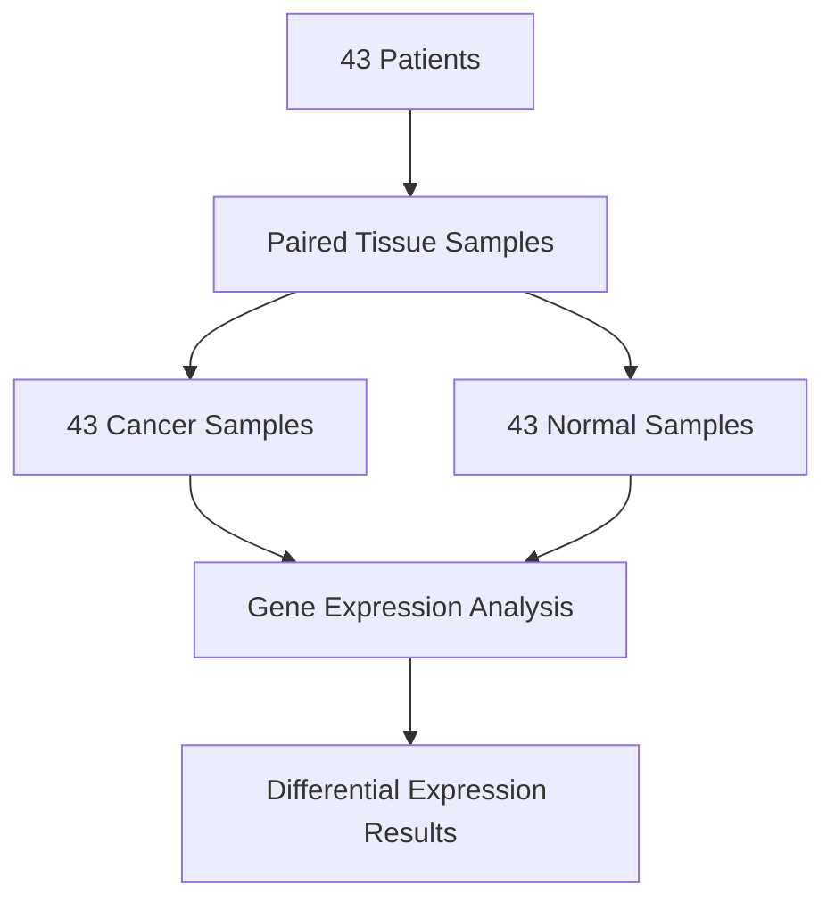
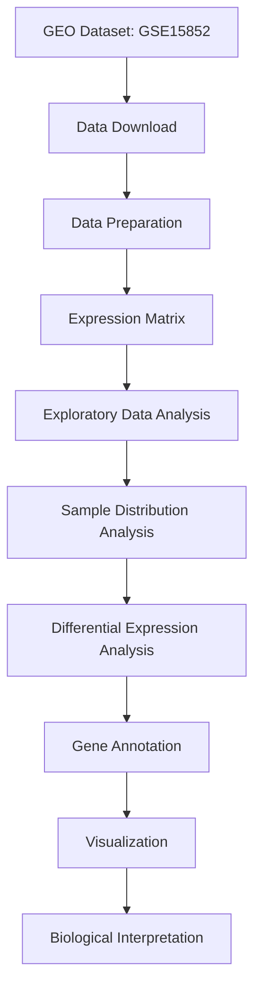
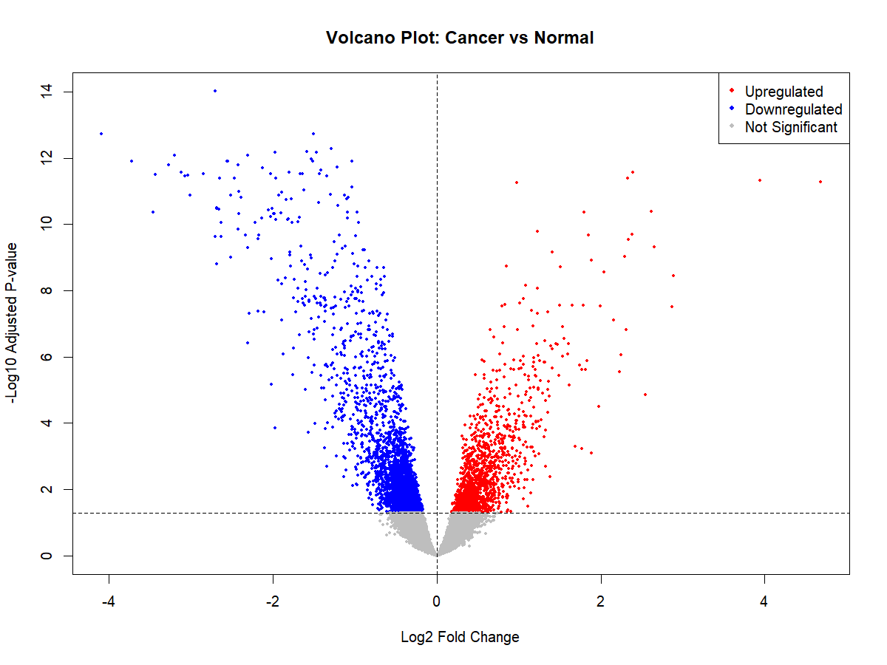
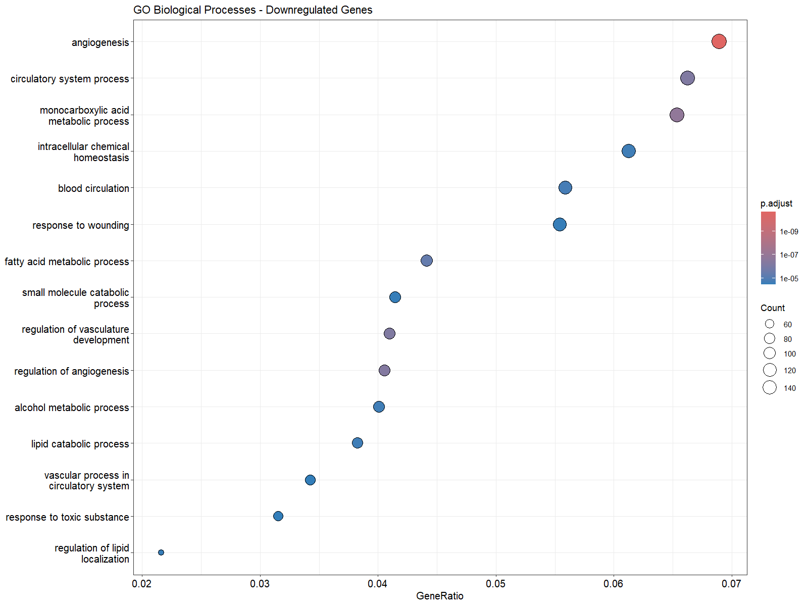
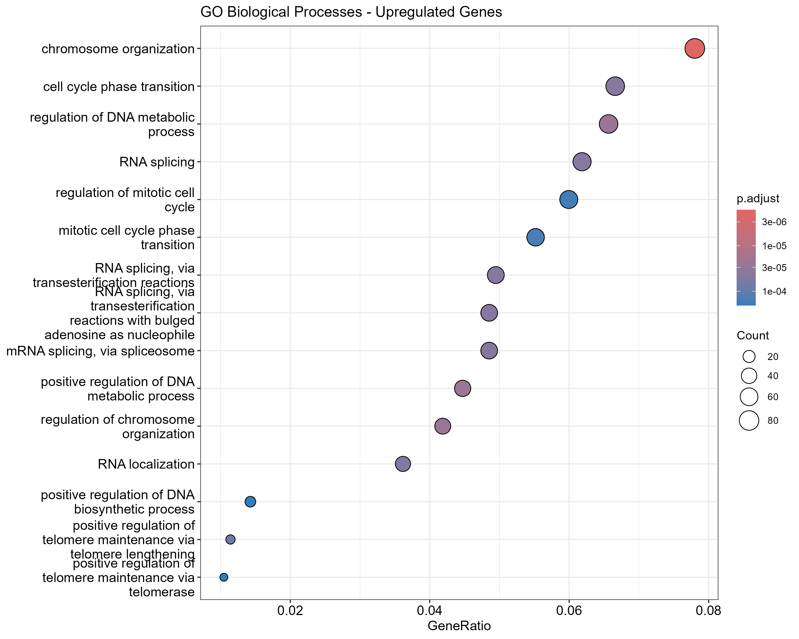
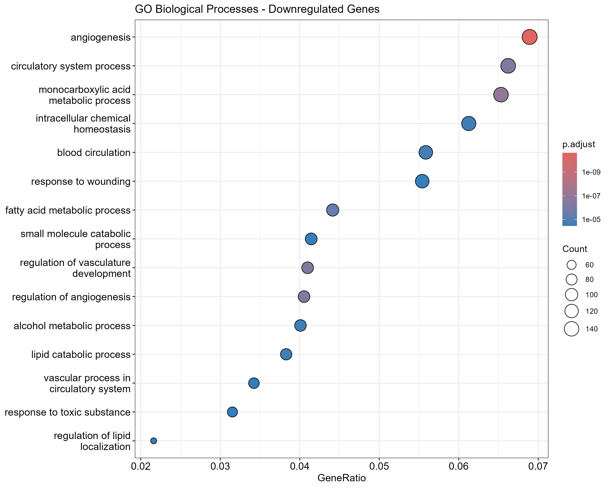

# Breast Cancer Differential Gene Expression Analysis

## Abstract

This project investigates gene expression differences between breast cancer and normal breast tissue using the publicly available GSE15852 dataset from the NCBI Gene Expression Omnibus (GEO). The dataset contains 86 samples from 43 patients, with paired cancer and normal tissue samples. Gene expression analysis was performed using the `limma` R package. Differentially expressed probes were identified using the Benjamini–Hochberg adjusted p-value method. Gene annotation was performed using the Affymetrix Human Genome U133A annotation database. A total of 4,274 probes were identified as significantly differentially expressed. Volcano plots and heatmaps were generated to visualize the findings.

## 1. Introduction

Gene expression analysis is an important bioinformatics approach for identifying genes associated with diseases. In cancer research, comparing gene expression patterns between cancerous and normal tissues can help identify molecular changes associated with cancer development.

Breast cancer is one of the most common cancers worldwide. Studying differences in gene expression between breast cancer and normal breast tissue can provide useful information about the molecular characteristics of the disease.

### 1.1 Aim

The main aim of this project is to identify differentially expressed genes between breast cancer and normal breast tissue using bioinformatics techniques and statistical analysis in R.

### 1.2 Objectives

- Obtain and prepare gene expression data from the NCBI GEO database.
- Explore the expression dataset and sample distribution.
- Perform differential gene expression analysis.
- Identify significantly upregulated and downregulated probes.
- Annotate probe IDs with gene symbols and gene names.
- Visualize differential expression results using volcano plots and heatmaps.

## 2. Dataset Description

The dataset used in this project was obtained from the NCBI Gene Expression Omnibus (GEO).

| Attribute | Description |
|---|---|
| GEO accession | GSE15852 |
| Organism | Homo sapiens |
| Platform | GPL96 |
| Technology | Affymetrix Human Genome U133A |
| Total samples | 86 |
| Cancer samples | 43 |
| Normal samples | 43 |
| Experimental design | Paired samples |
| Total probe sets | 22,283 |

Each of the 43 patients contributed one breast cancer tissue sample and one normal tissue sample.

**Data Ethics and Usage**

The dataset used in this project was obtained from the publicly accessible NCBI Gene Expression Omnibus (GEO) under accession number GSE15852. It is used for academic research, and the original dataset and related publication are acknowledged in the References section. No new human participants were recruited for this project, and no directly identifiable personal information was collected or used in the analysis. Users should refer to the original GEO record and its linked publication for further information about the dataset and its conditions of use.

### 2.1 Experimental Design

The dataset follows a paired experimental design. Each patient's cancer sample is compared with their corresponding normal sample.



## 3. Methodology

The analysis was conducted using R and RStudio. The workflow consisted of data acquisition, preprocessing, exploratory analysis, differential expression analysis, gene annotation, and visualization.

### 3.1 Overall Workflow



### 3.2 Data Acquisition and Preparation

The GSE15852 dataset was obtained from the NCBI GEO database.

The expression matrix was prepared for downstream analysis. The final expression matrix contained:

- 22,283 probe sets
- 86 samples

The sample information was organized according to cancer and normal tissue groups. Patient identifiers were used to maintain the paired sample structure.

### 3.3 Exploratory Data Analysis

Exploratory data analysis was performed to understand the expression dataset and sample characteristics.

The following activities were carried out:

- Inspection of the expression matrix dimensions.
- Examination of sample information.
- Calculation of sample-wise statistical summaries.
- Verification of cancer and normal sample distribution.
- Checking the consistency of sample identifiers.

### 3.4 Differential Gene Expression Analysis

Differential expression analysis was performed using the `limma` package.

A paired linear model was constructed using patient identifiers and tissue group information. The model was fitted using `lmFit()` and empirical Bayes moderation was applied using `eBayes()`.

The `topTable()` function was used to extract differential expression statistics.

The Benjamini–Hochberg method was applied to adjust p-values for multiple testing.

**Significance criterion:**

`Adjusted p-value < 0.05`

The log fold change (logFC) was used to determine the direction of expression:

- Positive logFC: Higher expression in cancer tissue.
- Negative logFC: Lower expression in cancer tissue.

### 3.5 Gene Annotation

Probe IDs were annotated using the `hgu133a.db` annotation package.

The following information was retrieved:

- Gene symbols
- Gene names

The `mapIds()` function from `AnnotationDbi` was used to map probe IDs to gene symbols and gene names.

For probes with multiple possible mappings, the first mapping was selected using `multiVals = "first"`.

### 3.6 Data Visualization

The following visualizations were generated:

- Volcano plot to display significantly upregulated and downregulated probes.
- Heatmap of the top 50 significant probes to examine expression patterns across samples.


## 4. Results

### 4.1 Differential Expression Results

A total of 22,283 probe sets were analyzed.

Using an adjusted p-value threshold of 0.05, 4,274 probes were identified as significantly differentially expressed.

| Result | Number of probes |
|---|---:|
| Total analyzed probes | 22,283 |
| Significant probes | 4,274 |
| Upregulated probes | 1,306 |
| Downregulated probes | 2,968 |

Upregulated probes showed higher expression in cancer tissue, whereas downregulated probes showed lower expression in cancer tissue.

### 4.2 Volcano Plot

The volcano plot illustrates the relationship between log fold change and adjusted p-values.

- Red points represent significantly upregulated probes.
- Blue points represent significantly downregulated probes.
- Grey points represent non-significant probes.



**Figure 1:** Volcano plot showing differentially expressed probes between breast cancer and normal tissue.

### 4.3 Heatmap Analysis

A heatmap was generated using the top 50 significant probes. Expression values were scaled across rows to highlight relative expression patterns.



**Figure 2:** Heatmap showing the expression patterns of the top 50 significant probes across the samples.

### 4.4 Gene Annotation Results

Probe annotation was performed using the Affymetrix Human Genome U133A annotation database.

| Annotation result | Number |
|---|---:|
| Total probes | 22,283 |
| Successfully annotated probes | 21,056 |
| Probes without gene symbols | 1,227 |
| Significant probes | 4,274 |
| Annotated significant probes | 4,138 |
| Significant probes without gene symbols | 136 |
| Unique annotated gene symbols among significant probes | 3,450 |

The annotation results provide gene-level information for interpreting the differential expression findings. Multiple probes may map to the same gene symbol.

### 4.5 Gene Ontology (GO) Biological Process Enrichment Analysis

GO Biological Process enrichment analysis was performed using the `clusterProfiler` R package to identify biological processes over-represented among upregulated and downregulated genes.

The analysis used the following parameters:

- Upregulated genes: 1,111 Entrez Gene IDs
- Downregulated genes: 2,388 Entrez Gene IDs
- Background genes: 13,041 Entrez Gene IDs
- GO category: Biological Process (BP)
- Multiple testing correction: Benjamini-Hochberg (BH)
- Adjusted p-value threshold: 0.05

A total of 208 enriched biological processes were identified among upregulated genes, while 483 enriched biological processes were identified among downregulated genes.

| Analysis | Number of enriched GO terms |
|---|---:|
| Upregulated genes | 208 |
| Downregulated genes | 483 |

**Top enriched biological processes**

**Upregulated genes:**
- Chromosome organization
- Regulation of DNA metabolic process
- Regulation of chromosome organization
- RNA splicing
- Cell cycle phase transition

**Downregulated genes:**
- Angiogenesis
- Monocarboxylic acid metabolic process
- Regulation of angiogenesis
- Circulatory system process
- Fatty acid metabolic process

These results indicate biological processes that are statistically over-represented in the respective gene sets. They suggest potential biological differences between breast cancer and normal tissue but do not independently establish pathway activation or suppression.

### 4.6 GO Enrichment Visualizations

Dot plots were generated to visualize the top 15 enriched biological processes for both upregulated and downregulated gene sets.

**Upregulated Genes**



**Figure 3:** GO Biological Process enrichment dot plot for upregulated genes.

**Downregulated Genes**



**Figure 4:** GO Biological Process enrichment dot plot for downregulated genes.

### 4.7 Generated Output Files

The analysis generated the following output files.

| File | Description |
|---|---|
| `all_differential_expression_results.csv` | Complete differential expression results |
| `significant_genes.csv` | Significant probes |
| `upregulated_genes.csv` | Upregulated probes |
| `downregulated_genes.csv` | Downregulated probes |
| `annotated_gene_expression_results.csv` | Complete annotated results |
| `annotated_significant_genes.csv` | Annotated significant probes |
| `annotated_upregulated_genes.csv` | Annotated upregulated probes |
| `annotated_downregulated_genes.csv` | Annotated downregulated probes |
| `sample_statistics.csv` | Sample-wise statistical summaries |
| `volcano_plot.png` | Volcano plot |
| `heatmap_top50_genes.png` | Heatmap of top 50 significant probes |
| `GO_upregulated_results.csv` | GO enrichment results for upregulated genes |
| `GO_downregulated_results.csv` | GO enrichment results for downregulated genes |
| `GO_upregulated_dotplot.png` | GO enrichment dot plot for upregulated genes |
| `GO_downregulated_dotplot.png` | GO enrichment dot plot for downregulated genes |

## 5. Discussion

The differential expression analysis identified 4,274 significantly differentially expressed probes between breast cancer and normal breast tissue.

Among these, 1,306 probes were upregulated and 2,968 probes were downregulated in cancer tissue based on their log fold change values.

Gene annotation successfully mapped 21,056 probes to gene symbols. Among the significant probes, 4,138 had gene-symbol annotations, representing 3,450 unique gene symbols.

The volcano plot provides an overview of the statistical significance and direction of expression changes. The heatmap provides a visual representation of expression patterns among the top 50 significant probes.

These findings demonstrate differences in gene expression between the two tissue groups. However, further biological interpretation and validation are required before drawing conclusions about the roles of individual genes in breast cancer.

### Future Work

Several improvements can be considered for future development of this project:

- **Pathway Analysis:** Extend the functional analysis using additional pathway databases such as KEGG and Reactome to gain further biological insights.
- **Candidate Gene Investigation:** Investigate important differentially expressed genes using relevant scientific literature and biological interaction networks.
- **Independent Dataset Validation:** Validate the identified differentially expressed genes using independent breast cancer gene expression datasets.
- **Clinical Data Integration:** Explore associations between gene expression patterns and available clinical or molecular subtype information.
- **Classification Models:** Investigate machine learning approaches for distinguishing breast cancer samples from normal samples using selected gene expression features, with appropriate independent validation.

  
## 7. Reproducibility

### 7.1 Software and Packages

The analysis was performed using:

- R version 4.6.2
- Bioconductor version 3.23
- RStudio

Main R packages:

- GEOquery
- Biobase
- limma
- hgu133a.db
- AnnotationDbi
- org.Hs.eg.db
- clusterProfiler
- enrichplot
- pheatmap

### 7.2 Project Structure

The project is organized into the following directory structure:

```text
2021-ASP-63/
│
├── code/
│   ├── 01_data_download_and_preparation.R
│   ├── 02_exploratory_data_analysis.R
│   ├── 03_sample_distribution.R
│   ├── 04_differential_expression_analysis.R
│   └── 05_GO_enrichment_analysis.R
│
├── data/
│
├── results/
│   ├── all_differential_expression_results.csv
│   ├── significant_genes.csv
│   ├── upregulated_genes.csv
│   ├── downregulated_genes.csv
│   ├── annotated_gene_expression_results.csv
│   ├── annotated_significant_genes.csv
│   ├── annotated_upregulated_genes.csv
│   ├── annotated_downregulated_genes.csv
│   ├── sample_statistics.csv
│   ├── GO_upregulated_results.csv
│   ├── GO_downregulated_results.csv
│   ├── volcano_plot.png
│   ├── heatmap_top50_genes.png
│   ├── GO_upregulated_dotplot.png
│   └── GO_downregulated_dotplot.png
│
├── .gitignore
├── 2021-ASP-63.Rproj
└── README.md
```

### 7.3 Running the Analysis

1. Clone or download the project repository.
2. Open the RStudio project.
3. Install the required R packages if they are not already installed.
4. Run the R scripts in numerical order from the `code/` directory.
5. Check the generated CSV files and visualizations in the `results/` directory.

## 8. References

1. NCBI Gene Expression Omnibus (GEO). GSE15852 dataset. https://www.ncbi.nlm.nih.gov/geo/query/acc.cgi?acc=GSE15852
2. Ritchie, M. E., et al. (2015). Limma powers differential expression analyses for RNA-sequencing and microarray studies. *Nucleic Acids Research*, 43(7), e47. https://doi.org/10.1093/nar/gkv007
3. Bioconductor. Limma package documentation. https://bioconductor.org/packages/limma/
4. Bioconductor. hgu133a.db package documentation. https://bioconductor.org/packages/hgu133a.db/
